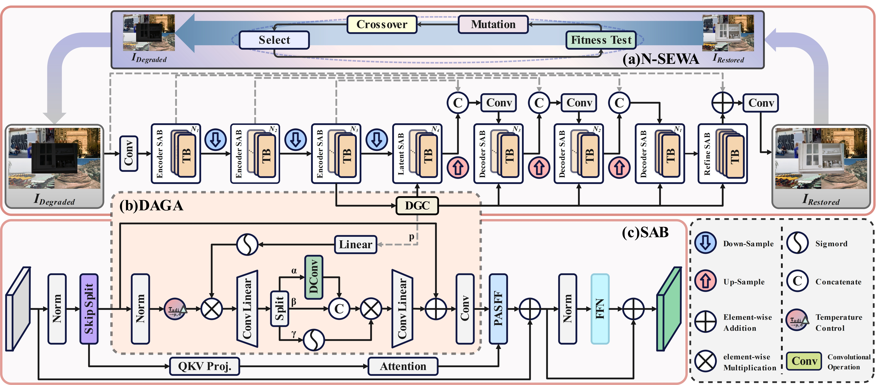

# SEOIR

<p align="center">
  <b>SEOIR: Simplex-Evolutionary Optimization for All-in-One Image Restoration</b><br/>
  A single compact network for denoising, deraining, dehazing, deblurring and low-light enhancement.
</p>

<p align="center">
  
  
  
</p>

<p align="center">
  <b>Yixiang Chen</b><sup>1</sup>, <b>Jinhua Wang</b><sup>1,&dagger;</sup>, <b>Ning He</b><sup>1</sup>,
  <b>Shiji Wang</b><sup>1</sup>, <b>Jinxiu Chen</b><sup>1</sup>, <b>Kangning Wang</b><sup>1</sup><br/>
  <sup>1</sup> Beijing Union University, Beijing, China<br/>
  <sup>&dagger;</sup> Corresponding authors: <a href="mailto:xxtwangjinhua@buu.edu.cn">xxtwangjinhua@buu.edu.cn</a>, <a href="mailto:xxthening@buu.edu.cn">xxthening@buu.edu.cn</a>
</p>

## News

- [x] `11/2026`: Code and qualitative results released.
- [ ] Quantitative results and pretrained checkpoints.

## Overview

All-in-one image restoration asks one network to undo several degradations — noise, rain, haze, blur and low light — with a single set of weights. The two usual escapes are to grow the model (task-specific prompts, adapters, or priors distilled from large vision-language models) or to keep several hand-tuned loss weights that have to be re-searched for every new setting. SEOIR takes neither route: the backbone stays compact, and the balancing act is moved into training as a search problem.

Concretely, SEOIR is built from three pieces:

- **N-SEWA — evolutionary weighting on the simplex.** A population of loss-weight vectors lives on the probability simplex. Every `--eos_interval` batches the population is scored on a sliding window of recent predictions, the fittest individual is kept, and new candidates are produced by convex crossover and Gaussian mutation. The formulation is dimension-agnostic: any number of loss terms can be balanced at once, and no manual grid search over weights is needed.
- **DAGA + DGC — degradation-conditioned gating.** The gated degradation-adaptation branch is conditioned on a degradation descriptor predicted by a lightweight degradation-guidance classifier. The same weights therefore behave differently for rain and for noise.
- **SAB + PASFF — pixel-adaptive spatial–frequency fusion.** Inside each spatial–frequency attention block, one half of the channels runs multi-head self-attention and the other half runs gated adaptation. The two outputs are fused in parallel — cross-enhanced in the spatial domain and summed in the frequency domain — and a predicted per-pixel map `λ(x)` decides, at every location, how much spatial and how much frequency evidence to keep. The map is zero-initialised, so training starts from the uniform `λ = 0.5` baseline and learns the trade-off from data.

### Highlights

- **One model, five degradations** — denoising (σ = 15/25/50), deraining, dehazing, deblurring and low-light enhancement share a single set of weights.
- **Loss weights that adapt** — N-SEWA replaces a fixed (α, β, γ) with weights evolved on the simplex, and extends to an arbitrary number of loss terms without changing the operator.
- **Pixel-adaptive fusion** — `λ(x)` replaces a global scalar, so the spatial and frequency branches can each win in different regions of the same image.
- **Compact by design** — base width 28 with a four-stage U-shaped encoder–decoder; no prompt banks and no auxiliary large models.

## Method

<p align="center">
  
</p>
<p align="center"><i>
Overview of SEOIR. (a) N-SEWA evolves the loss weights while the network is being trained. (b) DAGA: the gated degradation-adaptation branch, conditioned on the descriptor predicted by DGC. (c) SAB: half of the channels go through self-attention, the other half through gated adaptation, and PASFF fuses the two in the spatial and frequency domains with a per-pixel weight.
</i></p>

## Repository Layout

```text
SEOIR/
├── net/
│   └── seoir.py            # patch embedding, SAB stages, DAGA/DGC, PASFF, refinement
├── utils/                  # datasets, degradation synthesis, losses, metrics, schedulers
├── data_dir/               # image lists consumed by the training datasets
├── figs/                   # teaser and framework figures
├── options.py              # every command-line option (data, optimisation, N-SEWA)
├── train.py                # training entry point (contains the N-SEWA loop)
├── test.py                 # evaluation entry point
├── train_*.sh, test_*.sh   # SLURM templates — edit paths and entry script before use
└── requirements.txt
```

## Installation

### 1) Environment

```bash
conda create -n seoir python=3.9 -y
conda activate seoir
```

### 2) Dependencies

```bash
git clone https://github.com/cyx1c1c/SEOIR.git
cd SEOIR
pip install -r requirements.txt
```

`requirements.txt` installs `torch==2.0.0`, `torchvision==0.15.1` and `torchaudio==2.0.1` from the CUDA 11.8 wheel index. On a CPU-only machine, install PyTorch first and then the remaining packages.

### 3) Cluster note (optional)

```bash
export LD_LIBRARY_PATH=/opt/modules/nvidia-cuda-11.8.0/lib64:$LD_LIBRARY_PATH
export PATH=/opt/modules/nvidia-cuda-11.8.0/bin:$PATH
```

## Data Preparation

All paths are passed on the command line. **Keep the trailing slash** — the dataset code concatenates the directory string with relative file names.

| Task | Option | Expected layout |
| --- | --- | --- |
| Denoising | `--denoise_dir` | Flat folder of clean images. File names must appear in `data_dir/noisy/denoise.txt`; σ = 15/25/50 noise is synthesised on the fly. |
| Deraining | `--derain_dir` | `<derain_dir>/rainy/*.png`, ground truth in `<derain_dir>/gt/norain-*.png`; list in `data_dir/rainy/rainTrain.txt`. |
| Dehazing | `--dehaze_dir` | `<dehaze_dir>/synthetic/**/*.jpg`, ground truth in `<dehaze_dir>/original/`; list in `data_dir/hazy/hazy_outside.txt`. |
| Deblurring | `--gopro_dir` | `blur/` and `sharp/` sub-folders with matching file names (GoPro). |
| Enhancement | `--enhance_dir` | `low/` and `gt/` sub-folders with matching file names (LOL). |
| CDD11 | `--cdd11_path` | `<split>/clear/*.png` plus one folder per degradation combination, e.g. `low_haze_rain/`. |

The evaluation roots expect these sub-sets:

| Task | Root | Sub-set |
| --- | --- | --- |
| Denoising | `--denoise_path` | `bsd68/` |
| Deraining | `--derain_path` | `Rain100L/` |
| Dehazing | `--dehaze_path` | `SOTS/` |
| Deblurring | `--gopro_path` | `gopro/` |
| Enhancement | `--enhance_path` | `lol/` |

## Training

N-SEWA is active by default. The flags below reproduce the three standard settings.

> `--trainset SEOIR` names the multi-task data pipeline inherited from the baseline code — it selects a data loader, not a model. The three settings differ only in `--de_type` and in the data roots they read.

### A) 3-degradation setting

```bash
python train.py \
  --trainset SEOIR \
  --ckpt_dir train_ckpt/3deg \
  --de_type denoise_15 denoise_25 denoise_50 derain dehaze \
  --denoise_dir /path/to/Train/Denoise/ \
  --derain_dir /path/to/Train/Derain/ \
  --dehaze_dir /path/to/Train/Dehaze/ \
  --gopro_dir /path/to/Train/GoPro/ \
  --enhance_dir /path/to/Train/LOL/ \
  --num_gpus 1 \
  --batch_size 32 \
  --epochs 150 \
  --eos_interval 500 \
  --eos_pop_size 5 \
  --eos_generations 3 \
  --initial_l1_weight 0.7 \
  --initial_ssim_weight 0.2 \
  --initial_fft_weight 0.1
```

### B) 5-degradation setting

```bash
python train.py \
  --trainset SEOIR \
  --ckpt_dir train_ckpt/5deg \
  --de_type denoise_15 denoise_25 denoise_50 derain dehaze deblur enhance \
  --denoise_dir /path/to/Train/Denoise/ \
  --derain_dir /path/to/Train/Derain/ \
  --dehaze_dir /path/to/Train/Dehaze/ \
  --gopro_dir /path/to/Train/GoPro/ \
  --enhance_dir /path/to/Train/LOL/ \
  --num_gpus 1 \
  --batch_size 32 \
  --epochs 150 \
  --eos_interval 500 \
  --eos_pop_size 5 \
  --eos_generations 3
```

### C) CDD11 setting

```bash
python train.py \
  --trainset CDD11_all \
  --ckpt_dir train_ckpt/cdd11 \
  --cdd11_path /path/to/cdd11/ \
  --de_type denoise_15 denoise_25 denoise_50 derain dehaze \
  --num_gpus 1 \
  --batch_size 32 \
  --epochs 200
```

### Resuming

`--resume_from` is resolved relative to `--ckpt_dir`, e.g. `--resume_from epoch=70-step=307998.ckpt`. Drop the flag for a run from scratch.

## Evaluation

`test.py --mode` selects which tasks are evaluated:

| Mode | Setting |
| --- | --- |
| `0` | denoising only |
| `1` | deraining only |
| `2` | dehazing only |
| `3` | deblurring only |
| `4` | low-light enhancement only |
| `5` | three-task setting (denoise + derain + dehaze) |
| `6` | full five-task setting |

### Five-degradation evaluation

```bash
python test.py \
  --trainset SEOIR \
  --mode 6 \
  --denoise_path /path/to/test/Denoise/ \
  --derain_path /path/to/test/Derain/ \
  --dehaze_path /path/to/test/Dehaze/ \
  --gopro_path /path/to/test/Deblur/ \
  --enhance_path /path/to/test/Enhance/ \
  --ckpt_name 5deg/epoch=109-step=546700.ckpt \
  --output_path ./outputs/5deg_test
```

Checkpoints are looked up as `train_ckpt/<ckpt_name>`, PSNR / SSIM are printed per sub-set, and restored images are written to `--output_path`. Add `--use_lpips` to report LPIPS as well (noticeably slower).

### CDD11 evaluation

```bash
python test.py \
  --trainset CDD11_low_haze_rain \
  --cdd11_path /path/to/cdd11/ \
  --ckpt_name cdd11/epoch=154-step=378045.ckpt \
  --output_path ./outputs/cdd11_test
```

## Citation

If you find this work useful, please cite:

```bibtex
@misc{chen2026seoir,
  title        = {SEOIR: Simplex-Evolutionary Optimization for All-in-One Image Restoration},
  author       = {Chen, Yixiang and Wang, Jinhua and He, Ning and Wang, Shiji and Chen, Jinxiu and Wang, Kangning},
  year         = {2026},
  howpublished = {\url{https://github.com/cyx1c1c/SEOIR}},
  note         = {Code release}
}
```

## Acknowledgements

This repository builds on the code base of [AnyIR](https://github.com/Amazingren/AnyIR), and through it on [PromptIR](https://github.com/va1shn9v/PromptIR) and [AirNet](https://github.com/XLearning-SCU/2022-CVPR-AirNet). We thank the authors for making their work publicly available.

<details>
<summary>Contact</summary>

| Name | Email |
| --- | --- |
| Yixiang Chen | 20251081210215@buu.edu.cn |
| Jinhua Wang | xxtwangjinhua@buu.edu.cn |
| Ning He | xxthening@buu.edu.cn |
| Shiji Wang | 20251081210227@buu.edu.cn |
| Jinxiu Chen | 20251081210205@buu.edu.cn |
| Kangning Wang | 20252085410215@buu.edu.cn |

</details>
